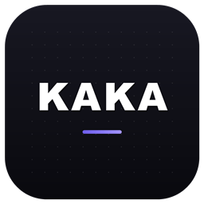
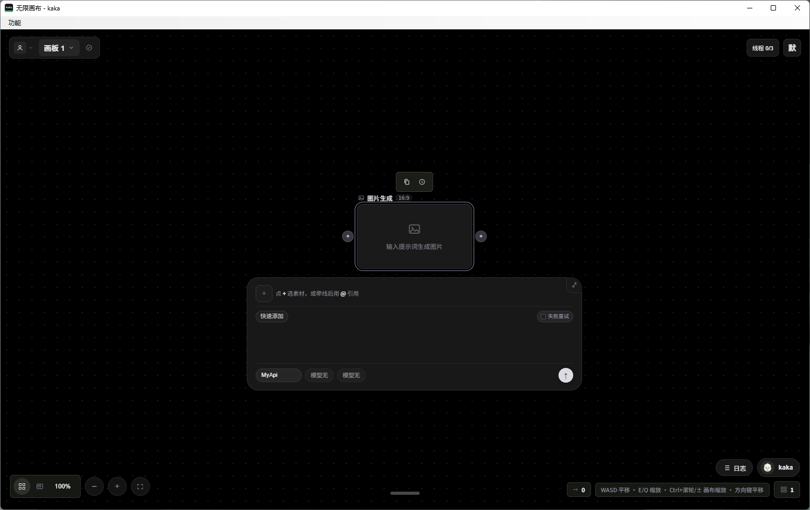

<p align="center">
  
</p>

<h1 align="center">无限画布</h1>

<p align="center">
  <a href="https://github.com/kakabian/kaka-infinite-canvas/stargazers"></a>
  
  
  
  
  
</p>

<p align="center">
  <a href="https://github.com/kakabian/kaka-infinite-canvas/releases/download/v1.0.1/kaka-canvas-portable-v1.0.1.zip"></a>
</p>

## 这是什么

一块能随便拖动的画布，上面放的是你的创作素材：提示词、分镜图、生成的视频、配音片段。节点就是素材，连线就是流程——摆好、接上，点一次就跑一整条。

做漫剧最耗时间的从来不是写提示词，是素材散在十几个文件夹和浏览器标签里，改一个镜头要来回翻。这里的思路很简单：把「素材」和「模型」摊到同一个平面上，看得见、改得动、跑得通。

整套程序跑在你自己的电脑上。模型账号是你自己的，这个软件不卖额度、不代收请求、不碰你的 Key。



## 它能干什么

- **四类节点同台**：文本、图片、视频、音频放在同一张画布上，连线之后下游一起生成
- **多路渠道**：设置里可以分别配图片、视频、文本、语音、视觉、智能体的 MyApi 地址，也能直接填火山引擎 Key
- **画布即工程**：画板、素材、渠道配置全在本机 `data/`，整个目录拷走就是迁移
- **视频超分**：内置 [Real-ESRGAN ncnn Vulkan](https://github.com/xinntao/Real-ESRGAN)（BSD 许可），第一次用到时自动下载，约 45 MB
- **双进程分工**：10027 只负责界面，8089 专门排队跑生成任务，出图的时候界面不卡
- **可选原生窗口**：不想开浏览器就双击 `画布窗口.exe`，用起来和普通桌面软件没区别

## 两种用法

**一、免安装便携版（推荐）**

到 [Releases](https://github.com/kakabian/kaka-infinite-canvas/releases) 下载 `kaka-canvas-portable-v1.0.1.zip`，解压，双击 `画布窗口.exe`。不用装 Python，整个文件夹拷到另一台 Windows 上照样能用。

**二、跑源码**

```bash
git clone https://github.com/kakabian/kaka-infinite-canvas.git
cd kaka-infinite-canvas
```

Windows 直接双击 `start.bat`：它会自己装依赖，然后同时拉起画布（10027）和任务服务（8089）。两个黑窗口都别关，关掉就停了。浏览器打开 http://127.0.0.1:10027。

习惯命令行的，两个终端分开跑：

```bash
pip install -r requirements.txt
python -m backend.run_worker
```

```bash
python run.py
```

更细的玩法写在 [使用教程](docs/使用教程.md)；想把这份代码传到自己的 GitHub 或 Gitee，看 [开源上传教程](docs/开源上传教程.md)。

## 需要准备什么

- Windows 10 / 11 最省事，macOS、Linux 也能跑（用命令行启动）
- [Python 3.10 以上](https://www.python.org/downloads/)，安装时记得勾 “Add python.exe to PATH”（只有源码模式需要）
- 一个你自己的模型接口地址和 Key：中转站、官方 API、火山引擎都行，本项目不带账号也不送额度
- 浏览器用 Chrome 或 Edge（源码模式）

## 提交前别带上这些

- `data/` —— 画板、素材、你填的 Key
- `.venv/` —— 本机装的 Python 依赖
- `.env` —— 你自己加的环境变量
- `*.zip` —— 打包产物，容易把旧配置一起带上去

`.gitignore` 里已经排掉了，但发之前还是扫一眼，确认压缩包里没有密钥。

## 自己打包

```powershell
powershell -ExecutionPolicy Bypass -File scripts\build_release.ps1
```

产物在 `dist\` 下。要给别人用又不想让他装 Python，就用 `scripts\build_release_server.ps1` 打成自带运行时的版本，再按 `dist\kaka-canvas-portable\` 的结构组装成绿色包。

## 它是怎么跑起来的

1. `frontend\` 是纯静态页面：HTML + CSS + 原生 JS，没有构建步骤，改完刷新就生效
2. `backend\` 是 FastAPI 服务，管画板数据、素材文件、渠道配置和登录
3. 10027 端口：界面和接口
4. 8089 端口：任务执行，真正去请求模型的那一端
5. `data\` 存画板、素材和密钥，`logs\` 存运行日志，两个都不进仓库

## 使用范围

个人学习、自己做片子、改着玩都没问题。转卖、收费、商用不行。完整约定见 [LICENSE](LICENSE) 与 [DISCLAIMER.md](DISCLAIMER.md)。软件按现状提供，不保证一直好用。